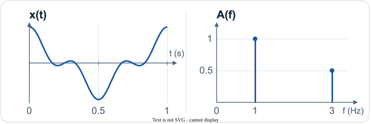

# Fourier Series: Why a Repeating Wave Has Harmonics

A waveform repeats once a second. Does that mean it contains only a 1 Hz tone? No: a 3 Hz tone makes three full cycles in that second, so it fits the same repeating pattern. A Fourier series separates two questions: which frequencies fit the period, and how much of each one does the waveform actually contain?

<!-- more -->

## What is a harmonic?

The **fundamental frequency** $f_0$ is how often the whole waveform repeats. If its shortest repeating pattern lasts one second, $f_0$ is 1 Hz.

A **harmonic** is a sinusoidal component whose frequency is a positive whole-number multiple of $f_0$. A component at $f_0$ is the first harmonic, one at $2f_0$ is the second, and one at $3f_0$ is the third. The number tells you how fast the component oscillates, not how strong it is. With a 1 Hz fundamental, even a weak 3 Hz component is the third harmonic, and it can be present even if there's no 2 Hz component.

## Which frequencies fit the period?

A waveform $x(t)$ is periodic if $x(t+T)=x(t)$ for all $t$. Take $T$ to be its shortest positive period. A sinusoid at frequency $f$ makes $fT$ cycles in time $T$. To repeat after $T$, it has to come back to the same point in its cycle, which means completing a whole number of cycles:

$$
fT=k \qquad\Longrightarrow\qquad f=\frac{k}{T}=kf_0,
\qquad f_0=\frac{1}{T}.
$$

For a one-second period, 1 Hz and 3 Hz both fit, but 1.5 Hz doesn't: after one second it's a half-cycle away from where it started. The $k=0$ term doesn't oscillate, so it isn't a harmonic. It represents the signal's average, also called **DC**.

## Read the harmonics of one waveform

Take $T=1\,\mathrm{s}$ and add two cosines:

$$
x(t)=\cos(2\pi f_0t)+\tfrac12\cos(2\pi\cdot 3f_0t),
\qquad f_0=1\,\mathrm{Hz}.
$$

The result isn't a single sinusoid, but it still repeats every second. Its first harmonic has amplitude 1 and its third harmonic has amplitude 0.5. There is no second harmonic and no DC offset. The plot on the right shows the amplitude of each cosine, not the height of the waveform at any particular time.

Those two stems don't tell us everything we need to rebuild the waveform. Change the plus sign before the 3 Hz cosine to a minus. Its frequency and amplitude stay the same, but it now starts at a trough instead of a peak. The right-hand plot would look identical, even though the waveform on the left would change. What changed was the **phase**: where the oscillation is in its cycle at $t=0$.

Take a cosine and a sine at the same frequency $f$. Multiply the cosine by $a$, multiply the sine by $b$, and add: $a\cos(2\pi ft)+b\sin(2\pi ft)$. These two multipliers, called **weights**, let us set both the amplitude and the starting phase.

??? note "Where do the sine and cosine weights come from?"

    **Start with one sinusoid.** Let $\theta=2\pi ft$. A cosine with amplitude $R$ and starting phase $\phi$ is $R\cos(\theta+\phi)$. The cosine addition formula splits it into two terms:

    $$
    \begin{aligned}
    R\cos(\theta+\phi)
      &=R\cos\phi\,\cos\theta-R\sin\phi\,\sin\theta\\
      &=a\cos\theta+b\sin\theta.
    \end{aligned}
    $$

    That's where $a=R\cos\phi$ and $b=-R\sin\phi$ come from. One number scales the cosine; the other scales the sine. Together they describe the amplitude and phase of the same tone.

    **Choose the weights for the amplitude you want.** The weights $a$ and $b$ are real numbers. Since $\cos^2\phi+\sin^2\phi=1$, the amplitude is $R=\sqrt{a^2+b^2}$. For amplitude 1, choose a pair with $a^2+b^2=1$, such as $a=3/5$ and $b=4/5$.

    **Does the shape change?** For a single tone, changing the weights can resize the wave vertically or shift it in time, but it stays sinusoidal at the same frequency unless both weights are zero. For example, $(a,b)=(1,0)$ starts at a peak, while $(0,1)$ starts at zero and rises. Both have amplitude 1; they differ only in phase. In a mixture of harmonics, changing one tone's amplitude or phase can change the shape of the *combined* waveform. That's what happened when we flipped the sign of the 3 Hz term but left the 1 Hz term alone.

The **complex Fourier series** rewrites each harmonic's cosine and sine weights as a pair of complex coefficients, one at the positive frequency and one at the negative frequency:

$$
x(t)=\sum_{k=-\infty}^{\infty} c_k\,e^{2\pi i k f_0 t},
\qquad f_0=\frac{1}{T}.
$$

Here $T$ is the period, and each integer $k$ labels the term at frequency $kf_0$.

For the $k$th harmonic ($k>0$), call the cosine weight $a_k$ and the sine weight $b_k$. These are the same $a$ and $b$ as above, with subscripts to show which harmonic they belong to. The coefficients at $+kf_0$ and $-kf_0$ are

$$
c_k=\frac{a_k-ib_k}{2},\qquad c_{-k}=\frac{a_k+ib_k}{2},
\qquad i^2=-1.
$$

The cosine weight gives both coefficients the same real part; the sine weight gives them opposite imaginary parts. Add the two exponential terms and you get back the original cosine and sine with weights $a_k$ and $b_k$.

??? note "The complex Fourier series at a glance"

    Here are the first few terms for a real waveform with fundamental frequency $f_0$:

    $$
    \begin{aligned}
    x(t)={}&c_0\\
      &+\bigl(c_1e^{2\pi i f_0t}+c_{-1}e^{-2\pi i f_0t}\bigr)\\
      &+\bigl(c_2e^{2\pi i(2f_0)t}+c_{-2}e^{-2\pi i(2f_0)t}\bigr)
        +\cdots.
    \end{aligned}
    $$

    The $c_k$ are **coefficients**: fixed numbers that multiply the terms. The subscript $k$ tells you which frequency the coefficient belongs to.

    - **$c_0$** is the average of the waveform over one period. It's a constant term at zero frequency.
    - **$c_1$ and $c_{-1}$** multiply the terms at $+f_0$ and $-f_0$, respectively. Those terms combine to make the first harmonic.
    - **$c_2$ and $c_{-2}$** do the same for the second harmonic at $\pm 2f_0$. The pattern continues for higher harmonics.

    **Recover the original weights.** Set $\theta=2\pi kf_0t$ and expand the two exponentials using [Euler's formula](eulers_formula.md). Reversing the angle leaves the cosine unchanged and flips the sign of the sine:

    $$
    \begin{aligned}
    c_ke^{i\theta}+c_{-k}e^{-i\theta}
      &=c_k(\cos\theta+i\sin\theta)+c_{-k}(\cos\theta-i\sin\theta)\\
      &=(c_k+c_{-k})\cos\theta+i(c_k-c_{-k})\sin\theta.
    \end{aligned}
    $$

    Now plug in the two coefficients. The cosine multiplies their **sum**; the sine multiplies $i$ times their **difference**:

    $$
    \begin{aligned}
    c_k+c_{-k}
      &=\frac{a_k-ib_k}{2}+\frac{a_k+ib_k}{2}=a_k,\\
    i(c_k-c_{-k})
      &=i\left(\frac{a_k-ib_k}{2}-\frac{a_k+ib_k}{2}\right)\\
      &=i(-ib_k)=b_k.
    \end{aligned}
    $$

    So the pair gives exactly $a_k\cos\theta+b_k\sin\theta$, the original real harmonic.

    **Read the amplitude and phase from the coefficients.** Write the same harmonic as a cosine with amplitude $R$ and starting phase $\phi$. The angle-addition formula gives

    $$
    R\cos(\theta+\phi)=R\cos\phi\,\cos\theta-R\sin\phi\,\sin\theta.
    $$

    Compare this with $a_k\cos\theta+b_k\sin\theta$. The multiplier of $\cos\theta$ is $a_k=R\cos\phi$, and the multiplier of $\sin\theta$ is $b_k=-R\sin\phi$. As a quick check, $\phi=\pi/2$ gives $R\cos(\theta+\pi/2)=-R\sin\theta$, so the sine weight is $-R$. Substituting the two weights into the complex coefficients gives

    $$
    \begin{aligned}
    c_k&=\frac{R}{2}\bigl(\cos\phi+i\sin\phi\bigr),\\
    c_{-k}&=\frac{R}{2}\bigl(\cos\phi-i\sin\phi\bigr),
    \qquad k>0.
    \end{aligned}
    $$

    The coefficients $c_k$ and $c_{-k}$ each have magnitude $R/2$ (the same distance from zero in the complex plane). If $R>0$, their angles are $\phi$ and $-\phi$, respectively, up to whole turns. The one-sided plot shows the full amplitude of the real harmonic, $R=2|c_k|$, because the harmonic comes from the pair. The constant term $c_0$ stands alone and gives the average directly.

    In the example above, $c_1=c_{-1}=\tfrac12$ gives amplitude 1 at 1 Hz, and $c_3=c_{-3}=\tfrac14$ gives amplitude 0.5 at 3 Hz. There is no 2 Hz component, so $c_2=c_{-2}=0$.

## Why the complex series has negative indices

The **index** is the subscript $k$ in $c_k$. Negative indices are $k=-1,-2,\ldots$, which label terms at frequencies $-f_0,-2f_0,\ldots$. For example, $c_{-1}$ is the coefficient for the term at $-f_0$.

To see what a negative frequency means, start with [Euler's formula](eulers_formula.md): $e^{i\theta}=\cos\theta+i\sin\theta$, where $i^2=-1$. You can picture $e^{i\theta}$ as a point rotating around the unit circle. A negative frequency reverses the direction of rotation. Averaging the two directions cancels the imaginary parts and gives a real cosine:

$$
\cos\theta=\frac{e^{i\theta}+e^{-i\theta}}{2}.
$$

To read the frequency of a complex exponential, write it in the form $e^{2\pi i f t}$. Its angle changes at $2\pi f$ radians per second. It makes $|f|$ turns per second, with the sign of $f$ indicating direction. Now substitute $\theta=2\pi kf_0t$ for a harmonic with $k>0$:

$$
\cos(2\pi kf_0t)
=\frac{e^{2\pi i(+kf_0)t}+e^{2\pi i(-kf_0)t}}{2}.
$$

Over one period $T=1/f_0$ of the waveform, the first exponential turns $k$ times counterclockwise and the second turns $k$ times clockwise. That places them at $+kf_0$ and $-kf_0$ on the two-sided spectrum. Together they represent one real cosine, not two separate tones.

For a piecewise-smooth waveform, the series recovers the waveform at every point where it's continuous. At a jump, it gives the average of the values approached from the left and right.

Each complex coefficient carries amplitude and phase information. For a real waveform, the terms at opposite frequencies pair up so that their sum is real. In our example, the 1 Hz cosine is split into $c_1=c_{-1}=\tfrac12$, and the 3 Hz cosine into $c_3=c_{-3}=\tfrac14$. The one-sided plot combines each pair into a single line, which is why its heights are 1 and 0.5 instead.

## How to pick out one coefficient

So far we've built a waveform from known coefficients. Now start with the waveform $x(t)$ and work backward: we want to measure just the coefficient $c_k$.

**Shift the frequency of interest to zero.** Use $j$ to label the terms in the series and keep $k$ fixed as the one we're looking for. The term $c_j e^{2\pi i jt/T}$ rotates at $j/T$ turns per second. Multiplying by $e^{-2\pi i kt/T}$ subtracts $k/T$ from that rate:

$$
c_j e^{2\pi i jt/T}\,e^{-2\pi i kt/T}
=c_j e^{2\pi i(j-k)t/T}.
$$

The minus sign is what cancels the rotation when $j=k$. That term becomes the constant $c_k$. Each other term still rotates, completing $|j-k|$ full turns in time $T$.

**Average over one full period.** The average of a function $g(t)$ over $[0,T]$ is its integral divided by $T$. Every rotating term has mean zero over that interval: its real and imaginary parts are a cosine and a sine that each complete a whole number of cycles. The constant $c_k$ keeps its value under averaging. For a finite sum of harmonics, we can average term by term and see exactly what survives:

$$
\begin{aligned}
\frac{1}{T}\int_0^T x(t)e^{-2\pi i kt/T}\,dt
&=\sum_j c_j\left(\frac{1}{T}\int_0^T e^{2\pi i(j-k)t/T}\,dt\right)\\
&=c_k.
\end{aligned}
$$

That's where the coefficient formula comes from:

$$
c_k=\frac{1}{T}\int_0^T x(t)e^{-2\pi i kt/T}\,dt.
$$

For example, to get $c_3$ from the waveform above, subtract 3 Hz from the frequency of every term. Only the term at $+3$ Hz lands at zero, so the average is its coefficient, $\tfrac14$. The term at $-3$ Hz shifts to $-6$ Hz and averages to zero.

The same formula applies to the piecewise-smooth waveforms discussed above even when their series has infinitely many terms. You can also use any interval of length $T$, not just $[0,T]$. At $k=0$ the multiplier is 1, so $c_0$ is simply the waveform's average.

??? note "Why the other terms average to zero"

    If $j=k$, the exponential is 1, so its integral over one period is $T$ and its average is 1. If $j\ne k$, the average is

    $$
    \frac{1}{T}\int_0^T e^{2\pi i(j-k)t/T}\,dt
      =\frac{e^{2\pi i(j-k)}-1}{2\pi i(j-k)}
      =0.
    $$

    The numerator is zero because the integer $j-k$ counts whole turns: $e^{2\pi i(j-k)}=1$. The fact that distinct Fourier terms give zero when one is multiplied by the other's opposite rotation and averaged is called **orthogonality**.

## Back to the sampling clock

An ideal sampling clock repeats every $T_s$, so its Fourier series can have terms only at $kf_s$, where $f_s=1/T_s$. The period tells us **where** to look; it doesn't tell us the weights. The clock is modeled as a train of impulses, so in the [sampling derivation](how_voice_becomes_bytes.md#sampling-clock-harmonics) we find the weights by applying the same coefficient formula over one period centered at zero. That period contains exactly one impulse.
