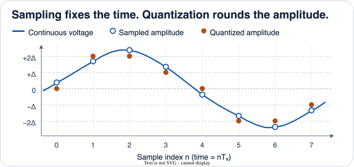

# How a Voice Recording Becomes a Sequence of Numbers

A recorder set to **16 kHz, 16-bit** makes two promises: how often it measures the microphone voltage, and how finely it rounds each measurement. Why does the first setting limit the frequencies we can recover, while the second changes the error in the values we store? The two answers come from different calculations.

<!-- more -->

## Sampling chooses the times

Let $x(t)$ be the analog voltage after the microphone's input filter. A uniform sampler measures it at times $t=nT_s$, where $T_s$ is the interval between measurements and $n$ is the sample index. The sample rate $f_s$ is the reciprocal of that interval:

$$
x[n]=x(nT_s), \qquad f_s=\frac{1}{T_s}.
$$

For $f_s=16{,}000\,\mathrm{Hz}$, the ADC takes a reading every $62.5\,\mu\mathrm{s}$ per channel. The open circles in the diagram are those readings. Their times are discrete, but their heights need not land on any of the horizontal levels. The filled circles show what the rounding stage does later.



### Why the sampled spectrum repeats

Imagine a train of unit impulses, one at each sampling time. This **Dirac comb** is a mathematical model of the sampling clock:

$$
s(t)=\sum_{n=-\infty}^{\infty}\delta(t-nT_s).
$$

Multiplying $x(t)$ by the comb keeps only the value at each impulse. The result $x_s(t)$ is still written as a continuous-time expression, but each impulse carries exactly one sample:

$$
\begin{aligned}
x_s(t)&=x(t)s(t)\\
      &=\sum_{n=-\infty}^{\infty}x[n]\,\delta(t-nT_s).
\end{aligned}
$$

Now look at the comb itself in frequency. Its period is $T_s$, so its Fourier series has harmonics at $k f_s$ for integer $k$. Over the period centered at zero there is just one unit impulse. In the coefficient integral the complex exponential equals one at that impulse, regardless of $k$:

$$
\begin{aligned}
c_k
  &=\frac{1}{T_s}\int_{-T_s/2}^{T_s/2}
       \delta(t)e^{-2\pi i k f_s t}\,dt\\
  &=\frac{1}{T_s}=f_s.
\end{aligned}
$$

Using frequency in hertz, each harmonic transforms to an impulse at $k f_s$. Thus the Fourier transform $S(f)$ of the time comb is another comb:

$$
S(f)=f_s\sum_{k=-\infty}^{\infty}\delta(f-kf_s).
$$

Multiplication in time becomes convolution in frequency. Convolving the original spectrum $X(f)$ with one shifted impulse copies $X(f)$ to that impulse's location. Convolving with the whole comb gives:

$$
\begin{aligned}
X_s(f)&=(X*S)(f)\\
      &=f_s\sum_{k=-\infty}^{\infty}X(f-kf_s).
\end{aligned}
$$

### Where the factor of two comes from

Suppose the original signal has no content outside $[-B,B]$. The central copy extends to $B$ on the right. The next copy is centered at $f_s$, so it begins at $f_s-B$. To leave a gap between them:

$$
f_s-B>B \qquad\Longleftrightarrow\qquad f_s>2B.
$$

When the copies are separate, an ideal low-pass filter can recover the central copy up to the known scale factor. When they overlap, the samples no longer tell us which copy a component came from. That's **aliasing**.

For a concrete example, take two zero-phase cosines, one at 5 kHz and one at 3 kHz, and sample at 8 kHz. At each integer index $n$ the 5 kHz cosine gives:

$$
\begin{aligned}
\cos\!\left(2\pi n\frac{5}{8}\right)
  &=\cos\!\left(2\pi n-2\pi n\frac{3}{8}\right)\\
  &=\cos\!\left(2\pi n\frac{3}{8}\right).
\end{aligned}
$$

No decoder could tell those two inputs apart from these samples. That is why the anti-aliasing filter goes **before** sampling. In narrowband telephony, passing speech up to about 3.4 kHz at an 8 kHz sample rate gives the filter room to roll off before the 4 kHz Nyquist frequency. Wideband speech can use 16 kHz; 44.1 and 48 kHz are common for general audio. [Analog Devices: sampling and aliasing](https://www.analog.com/en/resources/technical-articles/understanding-ac-behaviors-of-high-speed-adcs.html#sampling)

## Quantization chooses the values

Now return to the open and filled circles. At sample index 1, the voltage is about $1.7\Delta$, where $\Delta$ is the spacing between horizontal levels. The quantizer rounds it to $2\Delta$. It does not move the sample in time.

With $b$ bits there are $2^b$ possible codes. In a signed, uniform quantizer with a symmetric nominal input span $V_{\mathrm{pp}}$, one step is $\Delta=V_{\mathrm{pp}}/2^b$. In units of that step, the signed code bounds are $-2^{b-1}$ and $2^{b-1}-1$. First round the input, then clamp the result to those bounds:

$$
\begin{aligned}
k_{\mathrm{raw}}[n]
  &=\left\lfloor\frac{x[n]}{\Delta}+\frac12\right\rfloor,\\
k[n]&=\operatorname{clip}\bigl(k_{\mathrm{raw}}[n],\, k_{\min},\, k_{\max}\bigr),\\
x_q[n]&=\Delta\,k[n].
\end{aligned}
$$

The distinction matters: $k[n]$ is the **integer written to storage**; $x_q[n]$ is the voltage that integer represents. For a 16-bit input with a nominal range of $-1$ to $+1\,\mathrm{V}$:

$$
\begin{aligned}
\Delta &= \frac{2\,\mathrm{V}}{65{,}536}
          \approx 30.52\,\mu\mathrm{V},\\
x[n] &= 0.300\,\mathrm{V}
       \quad\Longrightarrow\quad k[n]=9830.
\end{aligned}
$$

The rounded code represents approximately $0.299988\,\mathrm{V}$, about $12.2\,\mu\mathrm{V}$ below the input. What happens if we repeat this calculation over an entire recording?

### Derive the quantization noise

Define the error as $e[n]=x[n]-x_q[n]$. When the code isn't clipped, rounding to the nearest level keeps the error in $[-\Delta/2,\Delta/2]$. To estimate its power, model the error as uniformly distributed over that interval. Its density is $1/\Delta$ there and zero outside.

The distribution is symmetric, so its mean is zero. Its noise power $P_N$ is the mean of the **squared** error, not the mean error:

$$
\begin{aligned}
P_N
  &=\mathbb{E}[e^2]
    =\int_{-\Delta/2}^{\Delta/2}e^2\,\frac{1}{\Delta}\,de\\
  &=\frac{2}{\Delta}\left[\frac{e^3}{3}\right]_{0}^{\Delta/2}\\
  &=\frac{\Delta^2}{12}.
\end{aligned}
$$

Compare that with a sine wave whose peak $A$ is nearly full scale, so $A\approx V_{\mathrm{pp}}/2=2^b\Delta/2$. The mean of $\sin^2$ over a period is $1/2$, which gives:

$$
\begin{aligned}
P_S &=\frac{A^2}{2}\approx\frac{2^{2b}\Delta^2}{8},\\
\frac{P_S}{P_N}
    &\approx \frac{2^{2b}\Delta^2/8}{\Delta^2/12}
     =\frac{3}{2}\,2^{2b}.
\end{aligned}
$$

The $\Delta^2$ terms cancel. Taking ten times the base-10 logarithm turns the product into a sum:

$$
\begin{aligned}
\mathrm{SQNR}_{\mathrm{dB}}
   &=10\log_{10}\!\left(\frac{P_S}{P_N}\right)\\
   &\approx 10\log_{10}\!\left(\frac32\right)
      +20b\log_{10}(2)\\
   &\approx 6.02b+1.76.
\end{aligned}
$$

At 16 bits that's about **98 dB** under the model. One extra bit halves the step size and cuts modeled noise power to a quarter, which is where the roughly 6 dB improvement comes from. This is a near-full-scale sine benchmark for an ideal quantizer, not a rating for a microphone. Real recordings can have analog noise or clipping, and a nearly constant input need not produce uniformly distributed rounding errors. [Analog Devices: quantization noise](https://www.analog.com/en/resources/technical-articles/understanding-ac-behaviors-of-high-speed-adcs.html#quantization)

## From one integer to a recording

**Linear PCM** stores the integer codes directly. A conventional 16-bit PCM WAV stores them in signed little-endian form. The code $9830$ from above is `0x2666`, so it takes two bytes: `66 26`. If the right channel reads $-0.300\,\mathrm{V}$ at that same instant, its code is $-9830$, or `0xd99a` in two's complement. The WAV payload holds the left sample followed by the right sample:

```text
             frame n              frame n+1
         left       right      left       right
         66 26      9a d9       …           …
```

The bytes by themselves don't specify a sample rate or even a channel count. WAV's `fmt ` chunk describes how to interpret them; its `data` chunk holds the payload. For packed PCM with $C$ channels, the payload bitrate $R$ (in bit/s) is:

$$
\begin{aligned}
R&=f_s\,b\,C\\
 &=16{,}000\times16\times1=256{,}000
     \qquad\text{(mono example)}.
\end{aligned}
$$

That's 32,000 bytes per second, or 1.92 MB per minute before the file header. A second of silence takes the same space as a second of speech. [Microsoft: RIFF chunks](https://learn.microsoft.com/en-us/windows/win32/xaudio2/resource-interchange-file-format--riff-)

## What if we don't store every code as-is?

- **G.711 compands individual samples.** Its A-law and μ-law use finer quantization near zero and coarser steps at larger amplitudes. With one 8-bit code per sample at 8 kHz, G.711 uses 64 kbit/s for a channel. [RFC 3551](https://www.rfc-editor.org/rfc/rfc3551.html#section-4.5.14)
- **FLAC can predict the next code and store the exact difference.** If the prediction $\hat{k}[n]$ is close, the residual $r[n]$ is small and can often be encoded in fewer bits. The decoder adds it back with no loss. [RFC 9639](https://www.rfc-editor.org/rfc/rfc9639.html#section-4)
- **Opus can spend fewer bits by encoding an approximation.** Depending on the mode, it uses linear prediction, a modified discrete cosine transform (MDCT), or both. At an average of 16 kbit/s, a minute is about 120 kB before container overhead, but decoding doesn't recover the exact original codes. [RFC 6716](https://www.rfc-editor.org/rfc/rfc6716.html#section-2)

The FLAC case is a useful distinction: **prediction is not inherently lossy**. Conceptually, a linear predictor with coefficients $a_j$ uses $p$ previous codes. If the encoder and decoder make the same prediction, storing the exact residual is enough:

$$
\begin{aligned}
\hat{k}[n] &= \sum_{j=1}^{p} a_j\,k[n-j],\\
r[n] &= k[n]-\hat{k}[n],\\
k[n] &= \hat{k}[n]+r[n].
\end{aligned}
$$

For instance, a predictor that repeats the previous code can encode `1000, 1004, 1007` as a starting value of `1000` and residuals of `4, 3`. FLAC can recover all three integers exactly. It still can't recover the frequencies discarded before sampling or the voltage between quantization levels. **Lossless here means lossless with respect to the stored samples, not the original sound wave.**

*Adapted from the [original Gemini conversation](https://share.gemini.google/KeLvpTx4wrB1).*
