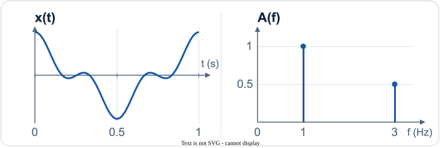

# 傅里叶级数：周期波形为什么有谐波？

一个波形每秒重复一次，是否意味着它只含有 1 Hz 的成分？并不是：3 Hz 的振荡在一秒内恰好走完三个周期，也能跟着整个波形每秒重复一次。傅里叶级数把这件事拆成两个问题：哪些频率能配合这个周期？波形里各有多少这样的成分？

<!-- more -->

## 什么是谐波？

**基频** $f_0$ 表示整个波形每秒重复多少次。如果最短的重复片段长一秒，基频就是 1 Hz。

**谐波**是一种正弦振荡成分，它的频率是基频的正整数倍。频率为 $f_0$ 的成分叫一次谐波，$2f_0$ 对应二次谐波，$3f_0$ 对应三次谐波。这里的“几次”说的是振荡有多快，不是幅度有多大。基频为 1 Hz 时，哪怕 3 Hz 成分很弱，它仍然是三次谐波；即使没有 2 Hz 成分，三次谐波也可以存在。

## 哪些频率能配合这个周期？

如果对所有 $t$ 都有 $x(t+T)=x(t)$，那么波形 $x(t)$ 就是周期的。这里取 $T$ 为最短的正周期。频率为 $f$ 的正弦振荡在时间 $T$ 内会走过 $fT$ 个周期。要在时间 $T$ 后回到循环中的同一个位置，就必须走完整数个周期：

$$
fT=k \qquad\Longrightarrow\qquad f=\frac{k}{T}=kf_0,
\qquad f_0=\frac{1}{T}.
$$

如果周期是一秒，那么 1 Hz 和 3 Hz 都符合这个条件，1.5 Hz 却不行：一秒后它还差半个周期才会回到起点。$k=0$ 这一项不振荡，因此不是谐波。它表示信号的平均值，也叫**直流分量**。

## 从一个波形里读出谐波

取 $T=1\,\mathrm{s}$，把两个余弦波相加：

$$
x(t)=\cos(2\pi f_0t)+\tfrac12\cos(2\pi\cdot 3f_0t),
\qquad f_0=1\,\mathrm{Hz}.
$$

相加后的结果不再是单个余弦波，却仍然每秒重复一次。一次谐波的幅度是 1，三次谐波的幅度是 0.5。它没有二次谐波，也没有直流偏移。右图的谱线高度表示各个余弦成分的幅度，并不是波形在某一个时刻的高度。

只看这两条谱线，还不能还原左图的波形。试着把 3 Hz 余弦项前面的加号换成减号。它的频率和幅度不变，却从波谷而不是波峰开始。这样一来，右图看起来一模一样，左图的波形却变了。这里改变的是**相位**，也就是振荡在 $t=0$ 时处于周期的什么位置。

取频率同为 $f$ 的余弦和正弦。把余弦乘以 $a$，正弦乘以 $b$，再相加：$a\cos(2\pi ft)+b\sin(2\pi ft)$。这两个乘数称为**权重**，用来设定振荡的幅度和初相位。

??? note "正弦和余弦的权重从哪来？"

    **从一个正弦振荡出发。** 令 $\theta=2\pi ft$。幅度为 $R$、初相位为 $\phi$ 的余弦可以写成 $R\cos(\theta+\phi)$。用余弦和角公式把它拆成两项：

    $$
    \begin{aligned}
    R\cos(\theta+\phi)
      &=R\cos\phi\,\cos\theta-R\sin\phi\,\sin\theta\\
      &=a\cos\theta+b\sin\theta.
    \end{aligned}
    $$

    这就是 $a=R\cos\phi$ 和 $b=-R\sin\phi$ 的来源。一个数乘在余弦上，另一个数乘在正弦上，两者共同描述同一个振荡的幅度和相位。

    **按所需的幅度选择权重。** 权重 $a$ 和 $b$ 都是实数。因为 $\cos^2\phi+\sin^2\phi=1$，所以幅度为 $R=\sqrt{a^2+b^2}$。要得到幅度为 1 的波形，就选一组满足 $a^2+b^2=1$ 的权重，例如 $a=3/5$、$b=4/5$。

    **波形会变吗？** 对于单个频率，改变权重可以让波形在竖直方向上伸缩，或沿时间轴平移。只要两个权重不同时为零，结果仍然是同一频率的正弦波。例如，$(a,b)=(1,0)$ 时从波峰开始，$(0,1)$ 时从零开始向上升。两者的幅度都是 1，差别只在相位。如果波形由多个谐波组成，改变其中一个谐波的幅度或相位，就有可能改变**叠加后的波形**。前面只改变 3 Hz 那一项的符号、不动 1 Hz 那一项，就是这样的例子。

**复数形式的傅里叶级数**把每个谐波的余弦权重和正弦权重改写成一对复数系数，分别对应正频率和负频率：

$$
x(t)=\sum_{k=-\infty}^{\infty} c_k\,e^{2\pi i k f_0 t},
\qquad f_0=\frac{1}{T}.
$$

这里 $T$ 是周期，每个整数下标 $k$ 对应频率为 $kf_0$ 的一项。

对于第 $k$ 次谐波（$k>0$），把余弦权重记作 $a_k$，正弦权重记作 $b_k$。它们就是前面的 $a$ 和 $b$，下标用来区分不同的谐波。频率 $+kf_0$ 和 $-kf_0$ 对应的系数分别为：

$$
c_k=\frac{a_k-ib_k}{2},\qquad c_{-k}=\frac{a_k+ib_k}{2},
\qquad i^2=-1.
$$

余弦权重决定两个系数相同的实部，正弦权重决定它们互为相反数的虚部。把两个指数项相加，就得到原来以 $a_k$ 和 $b_k$ 为权重的余弦项和正弦项。

??? note "复数形式的傅里叶级数一览"

    对于基频为 $f_0$ 的实数波形，把级数的前几项分组写出来：

    $$
    \begin{aligned}
    x(t)={}&c_0\\
      &+\bigl(c_1e^{2\pi i f_0t}+c_{-1}e^{-2\pi i f_0t}\bigr)\\
      &+\bigl(c_2e^{2\pi i(2f_0)t}+c_{-2}e^{-2\pi i(2f_0)t}\bigr)
        +\cdots.
    \end{aligned}
    $$

    $c_k$ 是**系数**，也就是乘在各项前面的固定数值。下标 $k$ 表示这个系数对应哪个频率。

    - **$c_0$** 是波形在一个周期内的平均值，是频率为零的常数项。
    - **$c_1$ 和 $c_{-1}$** 分别乘在频率为 $+f_0$ 和 $-f_0$ 的两项前面。这两项相加就得到一次谐波。
    - **$c_2$ 和 $c_{-2}$** 对应二次谐波的两项，频率分别为 $+2f_0$ 和 $-2f_0$。更高次的谐波依此类推。

    **还原原来的权重。** 令 $\theta=2\pi kf_0t$，用[欧拉公式](eulers_formula.md)展开两个指数项。角度变号时，余弦不变，正弦变号：

    $$
    \begin{aligned}
    c_ke^{i\theta}+c_{-k}e^{-i\theta}
      &=c_k(\cos\theta+i\sin\theta)+c_{-k}(\cos\theta-i\sin\theta)\\
      &=(c_k+c_{-k})\cos\theta+i(c_k-c_{-k})\sin\theta.
    \end{aligned}
    $$

    接着代入两个系数。余弦前面的系数是两者的**和**；正弦前面的系数是两者的**差**再乘以 $i$：

    $$
    \begin{aligned}
    c_k+c_{-k}
      &=\frac{a_k-ib_k}{2}+\frac{a_k+ib_k}{2}=a_k,\\
    i(c_k-c_{-k})
      &=i\left(\frac{a_k-ib_k}{2}-\frac{a_k+ib_k}{2}\right)\\
      &=i(-ib_k)=b_k.
    \end{aligned}
    $$

    所以这对指数项相加，恰好还原了原来的实数谐波 $a_k\cos\theta+b_k\sin\theta$。

    **从系数读出幅度和相位。** 把同一个谐波写成幅度为 $R$、初相位为 $\phi$ 的余弦波。用余弦和角公式展开：

    $$
    R\cos(\theta+\phi)=R\cos\phi\,\cos\theta-R\sin\phi\,\sin\theta.
    $$

    与 $a_k\cos\theta+b_k\sin\theta$ 对照，$\cos\theta$ 前面的权重是 $a_k=R\cos\phi$，$\sin\theta$ 前面的权重是 $b_k=-R\sin\phi$。例如，取 $\phi=\pi/2$，就有 $R\cos(\theta+\pi/2)=-R\sin\theta$，此时正弦权重就是 $-R$。把这两个权重代入复数系数，得到：

    $$
    \begin{aligned}
    c_k&=\frac{R}{2}\bigl(\cos\phi+i\sin\phi\bigr),\\
    c_{-k}&=\frac{R}{2}\bigl(\cos\phi-i\sin\phi\bigr),
    \qquad k>0.
    \end{aligned}
    $$

    系数 $c_k$ 和 $c_{-k}$ 的模（在复平面上到原点的距离）都是 $R/2$。当 $R>0$ 时，它们的辐角分别是 $\phi$ 和 $-\phi$，相差整圈的角度视为相同。单边频谱画的是这对项合成的实谐波的完整幅度 $R=2|c_k|$。常数项 $c_0$ 单独一项，直接给出波形的平均值。

    在前面的例子里，$c_1=c_{-1}=\tfrac12$ 对应 1 Hz 处的幅度 1，$c_3=c_{-3}=\tfrac14$ 对应 3 Hz 处的幅度 0.5。没有 2 Hz 成分，所以 $c_2=c_{-2}=0$。

## 复数形式为什么有负下标？

这里的**下标**就是系数 $c_k$ 中的 $k$。负下标 $k=-1,-2,\ldots$ 对应频率为 $-f_0,-2f_0,\ldots$ 的项。例如，$c_{-1}$ 就是频率为 $-f_0$ 那一项的系数。

要理解负频率的含义，先看[欧拉公式](eulers_formula.md)：$e^{i\theta}=\cos\theta+i\sin\theta$，其中 $i^2=-1$。可以把 $e^{i\theta}$ 想成单位圆上的一个旋转点。负频率意味着旋转方向相反。取两个方向的平均值，虚部抵消，只剩一个实数余弦：

$$
\cos\theta=\frac{e^{i\theta}+e^{-i\theta}}{2}.
$$

要从复指数读出频率，可以把它写成 $e^{2\pi i f t}$ 的形式。它的角度每秒变化 $2\pi f$ 弧度，也就是每秒转 $|f|$ 圈，方向由 $f$ 的符号决定。对于 $k>0$ 的谐波，代入 $\theta=2\pi kf_0t$：

$$
\cos(2\pi kf_0t)
=\frac{e^{2\pi i(+kf_0)t}+e^{2\pi i(-kf_0)t}}{2}.
$$

在波形的一个周期 $T=1/f_0$ 内，第一项逆时针转 $k$ 圈，第二项顺时针转 $k$ 圈。因此，在双边频谱上，它们分别位于 $+kf_0$ 和 $-kf_0$。这两项合在一起表示的是同一个实数余弦波。

对于分段光滑的波形，级数在每个连续点都能还原波形的值。如果波形在某一点发生跳变，级数给出的则是左右极限的平均值。

复数系数同时包含幅度和相位信息。对于实数波形，正、负频率成对出现，相加后结果仍是实数。在这个例子里，1 Hz 的余弦拆成 $c_1=c_{-1}=\tfrac12$，3 Hz 的余弦拆成 $c_3=c_{-3}=\tfrac14$。单边频谱把每一对合成一条谱线，所以图上的高度是 1 和 0.5。

## 怎么单独取出一个系数？

前面是用已知系数拼出波形。现在反过来，从已知的波形 $x(t)$ 出发，只求其中一个系数 $c_k$。

**先把要找的频率移到零。** 用 $j$ 遍历级数中的各项，把 $k$ 固定为要找的下标。第 $j$ 项 $c_j e^{2\pi i jt/T}$ 每秒转 $j/T$ 圈，乘以 $e^{-2\pi i kt/T}$，就从这个转速中减去 $k/T$：

$$
c_j e^{2\pi i jt/T}\,e^{-2\pi i kt/T}
=c_j e^{2\pi i(j-k)t/T}.
$$

指数里的负号正是用来抵消 $j=k$ 时的旋转。这一项变成常数 $c_k$；其余各项仍在转动，并在时间 $T$ 内转完 $|j-k|$ 整圈。

**再对一整个周期取平均。** 函数 $g(t)$ 在 $[0,T]$ 上的平均值，就是在这段时间上的积分除以 $T$。仍在转动的项，实部和虚部分别是走完整数个周期的余弦和正弦，所以平均值为零。常数 $c_k$ 取平均后则保持不变。先以有限个谐波的和为例，可以逐项取平均，看看最后剩下什么：

$$
\begin{aligned}
\frac{1}{T}\int_0^T x(t)e^{-2\pi i kt/T}\,dt
&=\sum_j c_j\left(\frac{1}{T}\int_0^T e^{2\pi i(j-k)t/T}\,dt\right)\\
&=c_k.
\end{aligned}
$$

这样就得到了系数公式：

$$
c_k=\frac{1}{T}\int_0^T x(t)e^{-2\pi i kt/T}\,dt.
$$

例如，要从前面的波形求出 $c_3$，就把每一项的频率都减去 3 Hz。只有原来在 $+3$ Hz 的项移到了零频率，因此平均值就是它的系数 $\tfrac14$。原来在 $-3$ Hz 的项移到 $-6$ Hz，取平均后为零。

对前面提到的分段光滑波形，即使级数有无穷多项，也可以用同一个公式。积分区间只要长度为 $T$，就不必从零开始。当 $k=0$ 时，乘上的指数项等于 1，所以 $c_0$ 就是波形的平均值。

??? note "为什么其余项的平均值是零？"

    当 $j=k$ 时，指数项恒为 1，所以一个周期内的积分是 $T$，平均值是 1。当 $j\ne k$ 时，平均值为：

    $$
    \frac{1}{T}\int_0^T e^{2\pi i(j-k)t/T}\,dt
      =\frac{e^{2\pi i(j-k)}-1}{2\pi i(j-k)}
      =0.
    $$

    分子为零，因为 $j-k$ 是整数，转完整数圈后 $e^{2\pi i(j-k)}=1$。对频率不同的两项，把其中一项乘以另一项的反向旋转，再取平均，结果为零。这就是傅里叶级数各项之间的**正交性**。

## 回到采样时钟

理想采样时钟每隔 $T_s$ 重复一次，所以它的傅里叶级数只可能在 $kf_s$ 处有项，其中 $f_s=1/T_s$。周期只告诉我们**哪些频率可能有成分**，并不告诉我们各项的权重。采样时钟用一列冲激来建模，因此在[采样推导](how_voice_becomes_bytes.md#sampling-clock-harmonics)里，我们用同一个系数公式，在以零为中心的一个周期内积分。这个周期里恰好只有一个冲激。
