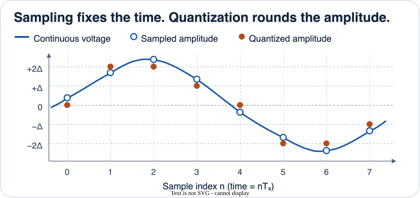

# 语音如何变成一串数字：从采样到 PCM

录音设置里的 **16 kHz、16 位**分别回答两个问题：多久测一次麦克风电压？用多细的刻度记录测得的电压？为什么第一个设置决定了哪些频率可以恢复，第二个设置却影响存下来的数值误差？要回答这两个问题，需要做两套不同的计算。

<!-- more -->

## 采样决定何时测量

用 $x(t)$ 表示麦克风信号经过输入滤波器后的模拟电压。均匀采样在 $t=nT_s$ 时测量电压，其中 $T_s$ 是两次测量之间的时间间隔，$n$ 是样本序号。采样率 $f_s$ 是采样间隔的倒数：

$$
x[n]=x(nT_s), \qquad f_s=\frac{1}{T_s}.
$$

当 $f_s=16{,}000\,\mathrm{Hz}$ 时，模数转换器（ADC）每隔 $62.5\,\mu\mathrm{s}$ 对每个声道测量一次。图中的空心圆就是测量结果。测量时刻是离散的，但测得的幅度不一定落在任何一条水平线上。实心圆则是随后舍入得到的结果。



### 为什么采样后的频谱会重复？

设想一列单位冲激，每个采样时刻恰好有一个。这列冲激称为**狄拉克梳状函数**，可以用来描述理想采样时钟：

$$
s(t)=\sum_{n=-\infty}^{\infty}\delta(t-nT_s).
$$

把 $x(t)$ 与这列冲激相乘，每个冲激只保留对应时刻的电压值。结果 $x_s(t)$ 仍写成连续时间的表达式，但每个冲激的权重恰好就是一个样本值：

$$
\begin{aligned}
x_s(t)&=x(t)s(t)\\
      &=\sum_{n=-\infty}^{\infty}x[n]\,\delta(t-nT_s).
\end{aligned}
$$

接下来看这列冲激的频谱。它以 $T_s$ 为周期，因此傅里叶级数的各个谐波位于 $k f_s$，其中 $k$ 是整数。以零为中心的一个周期内只有一个单位冲激。计算傅里叶系数时，无论 $k$ 取什么值，复指数在该冲激所在的 $t=0$ 处都等于 1：

$$
\begin{aligned}
c_k
  &=\frac{1}{T_s}\int_{-T_s/2}^{T_s/2}
       \delta(t)e^{-2\pi i k f_s t}\,dt\\
  &=\frac{1}{T_s}=f_s.
\end{aligned}
$$

以赫兹为频率单位时，每个谐波的傅里叶变换都是位于 $k f_s$ 的一个冲激。因此，时域梳状函数的傅里叶变换 $S(f)$ 在频域也是一个梳状函数：

$$
S(f)=f_s\sum_{k=-\infty}^{\infty}\delta(f-kf_s).
$$

时域相乘对应频域卷积。把原始频谱 $X(f)$ 与一个移位的冲激卷积，就得到一份平移到该冲激位置的频谱副本。与整列冲激卷积，则得到所有副本的叠加：

$$
\begin{aligned}
X_s(f)&=(X*S)(f)\\
      &=f_s\sum_{k=-\infty}^{\infty}X(f-kf_s).
\end{aligned}
$$

### 奈奎斯特采样条件里的两倍从哪来？

假设原始信号的频谱只分布在 $[-B,B]$ 内。中央副本的右边缘是 $B$，右边第一个副本以 $f_s$ 为中心，左边缘便是 $f_s-B$。要在两个副本之间留出间隔，必须满足：

$$
f_s-B>B \qquad\Longleftrightarrow\qquad f_s>2B.
$$

如果各副本互不重叠，就可以用理想低通滤波器取出中央副本，再消去已知的比例因子。如果副本发生重叠，只看样本就无法判断某个频率成分原本来自哪个副本。这就是**混叠**。

例如，用 8 kHz 的采样率分别测量初相位为零的 5 kHz 和 3 kHz 余弦信号。对任意整数样本序号 $n$，5 kHz 信号的采样值为：

$$
\begin{aligned}
\cos\!\left(2\pi n\frac{5}{8}\right)
  &=\cos\!\left(2\pi n-2\pi n\frac{3}{8}\right)\\
  &=\cos\!\left(2\pi n\frac{3}{8}\right).
\end{aligned}
$$

两种频率产生完全相同的样本，解码器无法区分。这就是抗混叠滤波器必须放在**采样之前**的原因。以窄带电话为例，8 kHz 采样时只保留到约 3.4 kHz 的语音成分，在 3.4 kHz 到 4 kHz 的奈奎斯特频率之间给滤波器留出过渡带。宽带语音的采样率可以是 16 kHz，通用音频则常用 44.1 kHz 或 48 kHz。[ADI：采样与混叠](https://www.analog.com/en/resources/technical-articles/understanding-ac-behaviors-of-high-speed-adcs.html#sampling)

## 量化决定存哪个数值

回到图中的空心圆和实心圆。样本序号为 1 时，测得的电压约为 $1.7\Delta$，其中 $\Delta$ 是相邻水平刻度之间的间距。量化器把它舍入到 $2\Delta$，但没有改变样本的时刻。

$b$ 位可以表示 $2^b$ 个码值。对于输入范围以零为中心的有符号均匀量化器，若标称输入范围的峰峰值为 $V_{\mathrm{pp}}$，量化步长就是 $\Delta=V_{\mathrm{pp}}/2^b$。有符号码值的下限 $k_{\min}$ 为 $-2^{b-1}$，上限 $k_{\max}$ 为 $2^{b-1}-1$。先对输入电压除以步长并舍入，再把结果限制在这个范围内：

$$
\begin{aligned}
k_{\mathrm{raw}}[n]
  &=\left\lfloor\frac{x[n]}{\Delta}+\frac12\right\rfloor,\\
k[n]&=\operatorname{clip}\bigl(k_{\mathrm{raw}}[n],\, k_{\min},\, k_{\max}\bigr),\\
x_q[n]&=\Delta\,k[n].
\end{aligned}
$$

这两个量要分清：$k[n]$ 是**写入存储的整数**，$x_q[n]$ 是这个整数所代表的电压。以 16 位量化、标称输入范围为 $-1$ 到 $+1\,\mathrm{V}$ 为例：

$$
\begin{aligned}
\Delta &= \frac{2\,\mathrm{V}}{65{,}536}
          \approx 30.52\,\mu\mathrm{V},\\
x[n] &= 0.300\,\mathrm{V}
       \quad\Longrightarrow\quad k[n]=9830.
\end{aligned}
$$

舍入后的码值代表约 $0.299988\,\mathrm{V}$，比输入低约 $12.2\,\mu\mathrm{V}$。如果把整段录音里的舍入误差都考虑进去，会得到怎样的结果？

### 推导量化噪声

把误差定义为 $e[n]=x[n]-x_q[n]$。在没有发生削波的前提下，舍入到最近的量化电平会把误差限制在 $[-\Delta/2,\Delta/2]$。为了估算误差功率，可以把误差近似看作在这个区间内均匀分布：区间内的概率密度是 $1/\Delta$，区间外为零。

这个分布关于零对称，所以误差的均值为零。但噪声功率 $P_N$ 取的是**误差平方的均值**，不是误差本身的均值：

$$
\begin{aligned}
P_N
  &=\mathbb{E}[e^2]
    =\int_{-\Delta/2}^{\Delta/2}e^2\,\frac{1}{\Delta}\,de\\
  &=\frac{2}{\Delta}\left[\frac{e^3}{3}\right]_{0}^{\Delta/2}\\
  &=\frac{\Delta^2}{12}.
\end{aligned}
$$

再取一个峰值 $A$ 接近满量程的正弦波，此时 $A\approx V_{\mathrm{pp}}/2=2^b\Delta/2$。因为 $\sin^2$ 在一个周期内的均值为 $1/2$，所以信号功率及其与噪声功率的比值分别为：

$$
\begin{aligned}
P_S &=\frac{A^2}{2}\approx\frac{2^{2b}\Delta^2}{8},\\
\frac{P_S}{P_N}
    &\approx \frac{2^{2b}\Delta^2/8}{\Delta^2/12}
     =\frac{3}{2}\,2^{2b}.
\end{aligned}
$$

分子和分母中的 $\Delta^2$ 抵消了。对功率比取以 10 为底的对数，再乘以 10，就得到以分贝表示的信号与量化噪声之比（SQNR）：

$$
\begin{aligned}
\mathrm{SQNR}_{\mathrm{dB}}
   &=10\log_{10}\!\left(\frac{P_S}{P_N}\right)\\
   &\approx 10\log_{10}\!\left(\frac32\right)
      +20b\log_{10}(2)\\
   &\approx 6.02b+1.76.
\end{aligned}
$$

按这个模型，16 位对应约 **98 dB**。每增加一位，步长减半，模型中的噪声功率降为原来的四分之一，因此 SQNR 约提高 6 dB。这个结果以理想量化器和接近满量程的正弦波为基准，并不是麦克风的性能指标。实际录音还可能受到模拟噪声和削波的影响；输入几乎不变时，舍入误差也未必服从均匀分布。[ADI：量化噪声](https://www.analog.com/en/resources/technical-articles/understanding-ac-behaviors-of-high-speed-adcs.html#quantization)

## 从一个整数到整段录音

**线性 PCM（脉冲编码调制）**直接存储量化得到的整数。常见的 16 位 PCM WAV 以有符号小端格式存储这些值。上面得到的码值 $9830$ 写成十六进制是 `0x2666`，对应的两个字节为 `66 26`。如果右声道在同一时刻测得 $-0.300\,\mathrm{V}$，码值就是 $-9830$，其 16 位补码为 `0xd99a`。在 WAV 的音频数据中，同一采样帧先存左声道样本，再存右声道样本：

```text
              帧 n                 帧 n+1
          左声道  右声道        左声道  右声道
          66 26   9a d9         …       …
```

这些字节本身既不说明采样率，也不说明声道数。WAV 的 `fmt ` 块给出解释它们所需的格式信息，`data` 块则存放音频数据。对于紧凑存储、含 $C$ 个声道的 PCM，音频数据的比特率 $R$ 以 bit/s 为单位。以 16 kHz、16 位的单声道录音为例：

$$
\begin{aligned}
R&=f_s\,b\,C\\
 &=16{,}000\times16\times1=256{,}000.
\end{aligned}
$$

这相当于每秒 32,000 字节，每分钟 1.92 MB，不计文件头。一秒静音和一秒讲话占用的空间一样大。[Microsoft：RIFF 数据块](https://learn.microsoft.com/en-us/windows/win32/xaudio2/resource-interchange-file-format--riff-)

## 如果不逐个原样存储码值呢？

- **G.711 对每个样本做压扩。** A 律和 μ 律在接近零的地方使用更细的量化步长，在幅度较大时使用更粗的步长。8 kHz 采样时每个样本用 8 位，每个声道的比特率是 64 kbit/s。[RFC 3551](https://www.rfc-editor.org/rfc/rfc3551.html#section-4.5.14)
- **FLAC 可以预测下一个码值，再精确记录预测误差。** 如果预测值 $\hat{k}[n]$ 足够接近真实值，残差 $r[n]$ 就比较小，通常可以用更少的位数编码。解码时把残差加回预测值，就能恢复原始数据。[RFC 9639](https://www.rfc-editor.org/rfc/rfc9639.html#section-4)
- **Opus 用近似换取更低的比特率。** 根据模式，它会使用线性预测、改进的离散余弦变换（MDCT），或将两者结合。平均比特率为 16 kbit/s 时，一分钟音频大约占 120 kB，不计容器开销，但解码不能精确还原原始码值。[RFC 6716](https://www.rfc-editor.org/rfc/rfc6716.html#section-2)

FLAC 说明了一个容易混淆的区别：**预测本身并不意味着有损**。从原理上看，一个线性预测器可以用系数 $a_j$ 对前 $p$ 个码值加权求和。只要编码器和解码器做出的预测一致，就只需要精确存下残差：

$$
\begin{aligned}
\hat{k}[n] &= \sum_{j=1}^{p} a_j\,k[n-j],\\
r[n] &= k[n]-\hat{k}[n],\\
k[n] &= \hat{k}[n]+r[n].
\end{aligned}
$$

例如，如果预测器总是用前一个码值作为预测，那么 `1000, 1004, 1007` 可以记成起始值 `1000` 和两个残差 `4, 3`。FLAC 可以精确恢复这三个整数，却不能找回采样前已经滤掉的频率，也不能重新分辨落在同一量化电平上的不同电压。**这里的“无损”是指样本编码前后完全一致，并不意味着原始声波可以毫无损失地恢复。**

*根据[最初的 Gemini 对话](https://share.gemini.google/KeLvpTx4wrB1)整理。*
